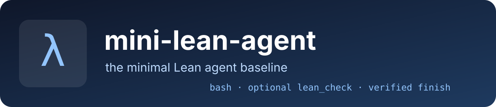

# mini-lean-agent

  

mini-lean-agent is a small, reproducible baseline for Lean 4 theorem-proving and formalization tasks.
It puts the language model and its tool interface at the center of the experiment rather than a
large orchestration scaffold.

Its core properties are:

- a single linear message history
- one fresh subprocess for each shell action
- persistent files but no persistent shell state
- controlled `bash` and `lean` toolsets
- local project verification and optional Kimina verification
- final submission checked by Lean and rejected on `sorry`
- complete JSON trajectories for research and debugging

## The central ablation

| Toolset | Tools | Question answered |
|---|---|---|
| `bash` | `bash` | How far can the model get using the shell as a universal interface? |
| `lean` | `bash`, `lean_check` | What is gained by one specialized Lean verification tool? |

The two modes share the same model adapter, prompt family, environment, limits, submission checker,
and trajectory format.

[Start with the quick-start guide](quickstart.md).
